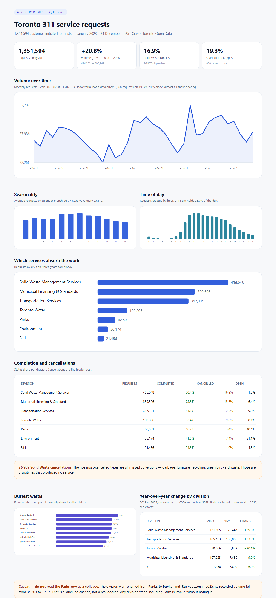

# Toronto 311 Service Requests — 2023 to 2025

An end-to-end analysis of 1,351,594 customer-initiated 311 requests: raw data →
SQLite → eight SQL questions → written findings.



**Question:** where is the volume, when does it arrive, and where is it being
wasted?

## Headline numbers

| Measure | Value |
|---|---|
| Requests analysed | **1,351,594** |
| Period | 1 Jan 2023 – 31 Dec 2025 |
| Yearly growth | **+20.8%** (414,282 → 500,269) |
| Distinct request types | **830** |
| Share of the top 8 types | **19.3%** |
| Solid Waste cancellations | **76,987** (16.9% of its volume) |
| Busiest hours | 9–11 am (**25.7%** of all requests) |
| Busiest vs quietest month | July 135,118 vs January 99,337 (**+36%**) |
| Peak single month | **Feb 2025 — 53,707**, driven by a snowstorm |

## Three findings

**1. Volume is growing, and the growth is concentrated in two divisions.**
Requests rose 20.8% in two years. Solid Waste (+29.8%, 131k → 170k) and
Transportation (+23.3%, 105k → 130k) account for most of it. Municipal Licensing
grew only 9%.

**2. Demand is unusually dispersed, and it spikes with weather.** 830 request
types, and the eight largest together are 19.3% of volume — the single biggest
(*Injured – Wildlife*, 51,471) is just 3.8%. There is no "top 10" that explains
the service. The trend also isn't smooth: February 2025 hit 53,707 requests
against a monthly norm near 33,000, because 19 February alone produced 6,168
snow-clearing requests. Capacity planning needs a shock scenario, not just an
average month.

**3. Cancellation is the buried cost.** 76,987 Solid Waste requests were
cancelled — 16.9% of that division's volume, against 2.5% for Transportation.
The five largest cancelled types are all missed-collection complaints (garbage,
furniture, recycling, green bin, yard waste): 36,079 of them. Those are
dispatches that produced no service.

## Recommendation

Before adding collection capacity, **attack the 17% cancellation rate on missed
pickups.** Even a quarter reduction is roughly 19,000 fewer wasted dispatches
over three years — the same operational gain as hiring, without the cost. Start
by checking whether the cancellations trace to repeat addresses or to a single
route/day pattern.

## Caveat

**Do not compare Parks year over year.** The division was renamed from `Parks`
to `Parks and Recreation` in 2025 and its recorded volume collapsed from 34,203
(2024) to 1,437 — a labelling/pipeline change, not a real drop in park work. Any
division-level trend that includes Parks is invalid. This is the kind of thing a
dashboard would have shown as a dramatic "‑96%" and a analyst would have had to
catch.

## Data

- **Source:** City of Toronto Open Data, [311 Service Requests – Customer
  Initiated](https://open.toronto.ca/dataset/311-service-requests-customer-initiated/)
- **Licence:** Open Government Licence – Toronto
- **Downloaded:** 9 November 2026
- **Files:** `SR2023.csv`, `SR2024.csv`, `SR2025.csv` (the 2025 file is cp1252,
  the others UTF-8 — the loader detects both)

### Data dictionary

| Column | Type | Meaning |
|---|---|---|
| `id` | integer | Surrogate key, assigned on load |
| `creation_date` | text | Request timestamp, `YYYY-MM-DDTHH:00:00` (minutes/seconds dropped) |
| `year` | integer | Derived from `creation_date` |
| `month` | text | `YYYY-MM`, derived — used for monthly counts |
| `hour` | integer | Hour of creation, 0–23 |
| `status` | text | `Completed`, `Cancelled`, `In Progress`, `New`, `Closed`; 1.5% null |
| `postal_prefix` | text | First 3 characters of postal code (e.g. `M5V`), uppercased |
| `street_1`, `street_2` | text | Intersection streets; **84.9% null** (most records are postal-code only) |
| `ward` | text | Ward name without the number, e.g. `Etobicoke-Lakeshore` |
| `ward_code` | text | Two-digit ward number, `03` |
| `request_type` | text | Service request category (830 distinct) |
| `division` | text | Responsible division; 1.1% null |
| `section` | text | Sub-unit within the division; 1.1% null |

### Cleaning decisions

- Rows with an unparseable `Creation Date`: **0** — every row loaded.
- `Ward` was split into name + code; 24 rows have no ward (kept, excluded from
  ward queries).
- Minutes and seconds dropped from timestamps — the analysis is hourly at finest.
- `NULL`, `N/A`, `UNKNOWN` normalised to SQL null.
- No deduplication: identical rows can be genuinely separate requests, and the
  dataset has no stable request ID.

## Reproduce it

```bash
# 1. download the three yearly ZIPs into data/raw (links in the README table above)
# 2. extract into data/extracted/<year>/SR<year>.csv
python etl/build_db.py      # builds toronto311.db  (~1.35M rows)
python run_queries.py       # runs queries.sql -> output/*.csv
```

Standard library only — no pandas, no dependencies.

## Files

```
etl/build_db.py      CSV -> SQLite, cleaning, indexes
queries.sql          eight questions, each labelled
run_queries.py       executes queries.sql, writes output/*.csv
output/              one CSV per question
```

## What this data cannot tell you

- **Time to resolution** — there is no closed date in this extract.
- **Per-capita rates** — no population by ward in this dataset; ward totals are
  raw counts, so a large ward will always look "worse".
- **Which requests were duplicated** — no stable ID across years.
- **Whether a cancellation was customer-requested or missed** — the status alone
  doesn't say.
